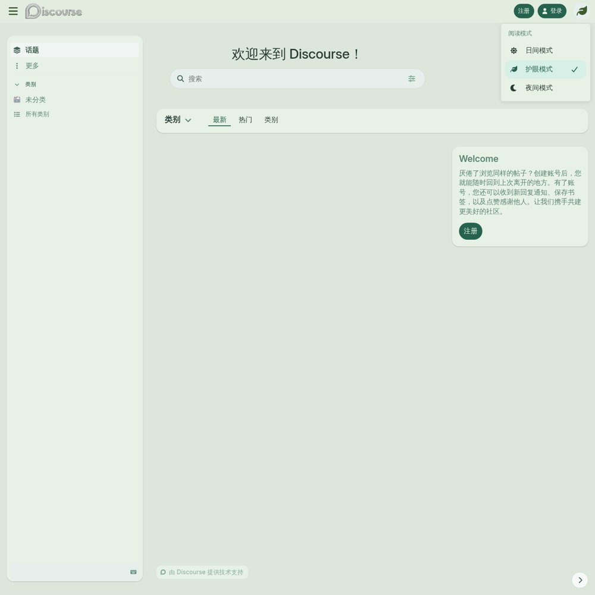
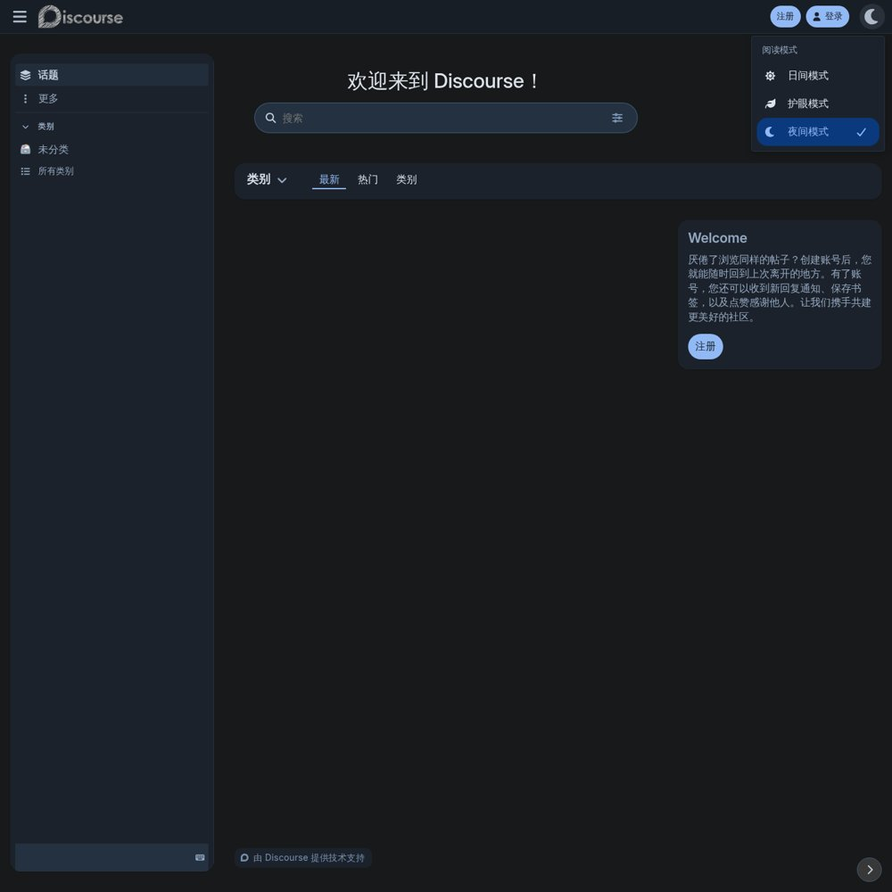
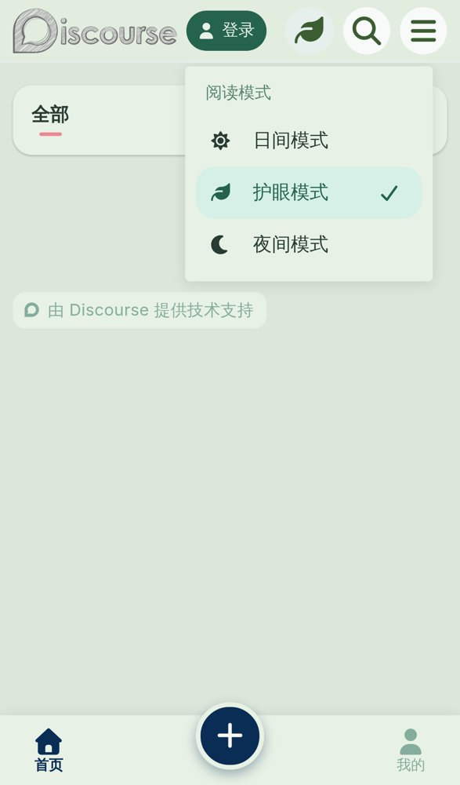

# 阅读模式

页首按钮支持日间、浅绿色护眼和夜间模式。使用 Discourse 原生配色，当前浏览器通过 Cookie 记住选择；返回日间时恢复原有配色。加载失败保留当前颜色并允许重试，支持手机、电脑和键盘。

## 管理员配置

1. 将本仓库 `extras/reading-mode-palettes/` 中的 `about.json` 打成 tar.gz，在后台导入为「KUU 阅读配色」。这是配色包，不要设为默认主题。
2. 在配色页启用 `KUU Eye Comfort` 的用户可选属性，记下它的 ID。
3. 给官网正在使用的 FKB Pro 主题配置独立的夜间配色；已有夜间配色继续使用，也可以选附带的 `KUU Night`。
4. 在「KUU 自定义组件」中填写 `eye_comfort_palette_id`，再开启 `reading_mode_enabled`。新开关默认关闭，更新组件后先配置配色再启用。若父主题仅允许自身配色，先将护眼配色复制到父主题下并填写新 ID。
5. 分别用电脑和 iPhone Safari 真机检查首页、普通帖子、评分页面、底栏和聊天。自动化手机测试使用 Chromium，真机检查由 David 完成。

按钮替代顶部原生日夜入口，侧栏原生入口保留。已有分类、底栏和分享等功能保留。FKB 留白与信息卡跟随护眼配色；夜间调整组件中品牌文字的对比度。

## 提交与上线

在本仓库走 PR，CI 通过并由 David 批准、合并后，再由 David 到官网后台更新组件并配置开关。

## 回退

先切换回日间，再关闭 `reading_mode_enabled`，顶部恢复原生入口。需要清理已保留的护眼选择时，可在个人界面配色选项恢复默认，或清除本浏览器本站 Cookie。确认没有人使用后再移除附带配色包。

## 本地预览截图

以下为 FKB Pro 下的本地自动化测试截图；手机视图由 Chromium 模拟。

| 电脑护眼 | 电脑夜间 |
| --- | --- |
|  |  |

| 手机护眼 | 手机夜间 |
| --- | --- |
|  |  |
